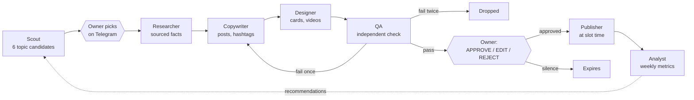
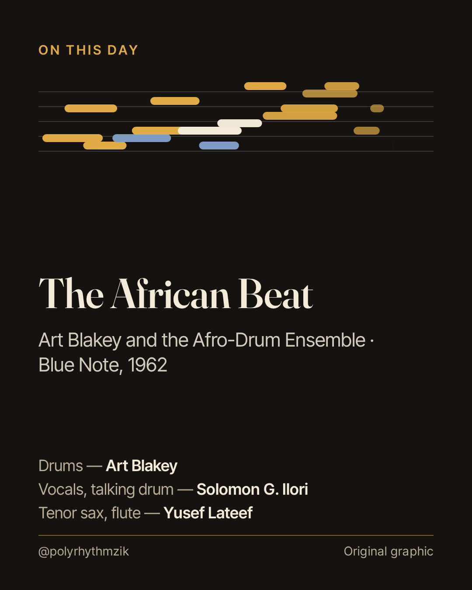
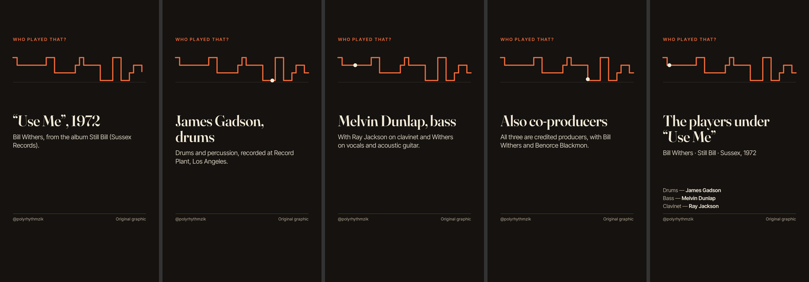

# Polyrhythm Studio — a music media run by AI agents, approved by a human

> Showcase repository. It presents the design of a multi-agent content pipeline that has been running in
> production since October 2026, and the plan to rebuild it on LangGraph with a conversational layer
> (Hermes Agent). The production repository is private. [Version française](README.fr.md)
>
> **Pitch deck (French):** [Polyrhythm Studio — pitch](https://claude.ai/artifact/HuzaBwHC89rPKnX1V5ratd)

Polyrhythm is an English-language music media covering **jazz, funk & soul, Afrobeat & West African music, and
Latin & Caribbean music**. Every day, a team of specialised agents proposes topics, researches and sources every
fact, writes the posts, renders original visuals and videos, checks everything, and sends the drafts to the owner
on Telegram. **Nothing is published without an explicit human approval.** Approved posts go out on X, Instagram,
Facebook, TikTok, YouTube Shorts, Threads and Bluesky.

| 3 | 7 | 6 | 0 |
|---|---|---|---|
| posts a day, at fixed slots | platforms from one draft | specialised agents, 5 scheduled routines | posts published without approval |

## How it works


A day in the studio:
- **D−1 08:00 UTC** — the scout sends a slate: 3 slots × 2 candidates, with verified anniversaries for the date.
- **D−1 19:00 UTC** — the coordinator drafts the three posts in parallel through researcher → copywriter →
  designer → QA, then sends each package (text, sources, visual, video) to Telegram.
- **D, 08:00 / 13:00 / 18:00 UTC** — the publisher posts each approved draft; an unapproved one expires.
- **Every Monday** — the analyst reads real metrics and writes recommendations the other agents follow.
- **Every morning** — a reply kit: verified news and sourced reply ideas the owner uses by hand on X.

## Design choices
| Choice | Why |
|---|---|
| **Narrow, specialised agents** ([.claude/agents/](.claude/agents/)) | Each has one role, its own tools and an output contract: easier to test, debug and replace. |
| **Human in the loop** | Approval is mandatory; silence means expiry, never publication. |
| **Every fact has a source** | URL + retrieval date for each claim; opinion is labelled ("To my ear…"). |
| **Independent QA, two attempts** | A failure goes back to the responsible agent; two failures drop the post. Accuracy beats volume. |
| **Deterministic tools for everything that can be code** | Rendering (Puppeteer + ffmpeg), format checks, status updates, Telegram — tested, not prompted. |
| **Learning loop** | Weekly insights from real metrics feed topic and format choices. |
| **The contract lives in the repo** ([CLAUDE.md](CLAUDE.md)) | Every owner decision is dated in the rules; agents read them on every run. |

## Incidents that became rules
- **Threads cut short** — X caps uploads at 10 per 24 h; two five-post threads lost their last post.
  → threads ≤ 4 posts, budget checked before posting, never half a thread.
- **Wrong account** — an optional platform was connected to personal accounts.
  → an allow-list of accounts; anything else is skipped and reported.
- **Expired drafts** — 6 of 18 drafts expired in week one. → reminders at 07:00 and 13:00, deadline in each draft.
- **Music rights** — real recordings are used only through the platforms' own catalogues (TikTok sound by id,
  Instagram/Facebook song added by the owner in-app); our files only carry licensed library tracks, each with
  dated licence evidence ([audio/](audio/)).

## From data to decisions
The first week's TikTok numbers ([log/insights.md](log/insights.md)): about half the viewers left within 1 second,
nine in ten within 3. The renderer faded every scene in, so **frame 0 was an empty screen**. Fix: the hook is
visible from the first frame, a 7–10 s cut, and on-screen text in French (45–85 % of viewers were
French-speaking). Engagement figures exclude the owner's own accounts and are reported as ranges.

## Example output
Three real packages in [examples/](examples/): brief, sourced text, QA report, card and video stills.

| Card (X, Instagram, Facebook) | Vertical video stills (TikTok) |
|---|---|
|  |  |

## Repository map
| Path | What |
|---|---|
| [CLAUDE.md](CLAUDE.md) | The agent contract: slots, rules, accounts, files |
| [.claude/agents/](.claude/agents/) | Sub-agents: scout, researcher, copywriter, visual and motion designers, QA |
| [prompts/](prompts/) | Scheduled routines: proposer, coordinator, publisher, analyst, reply kit |
| [render/](render/) | Original visuals: cards, clips, 9:16 videos, carousels (HTML template → Puppeteer → ffmpeg) |
| [scripts/](scripts/) | Telegram review channel, format and hashtag checks, music note, status updates |
| [tests/](tests/) | `npm test` — 27 tests |
| [docs/](docs/) | Editorial guidelines, scope and cultural care, routines, profile texts |
| [audio/](audio/) | Licensed music library records and licence evidence (audio files not included) |
| [migration/](migration/) | Rebuild plan on LangGraph (architecture, phases, costs, risks) |
| [docs/roadmap-hermes.md](docs/roadmap-hermes.md) | Next step: talk to the media through Hermes Agent |

## Roadmap
1. **LangGraph** ([migration/](migration/)) — one graph per post with typed state and a Postgres checkpointer;
   `interrupt()` makes publication impossible without a recorded human decision; quotas, allowed accounts and
   music licences become tested guards instead of prompt instructions; traces and cost per post in LangSmith.
   Estimated run cost: about $115 a month (range $70–225).
2. **Hermes Agent** ([docs/roadmap-hermes.md](docs/roadmap-hermes.md)) — a conversational layer on top of the
   graphs: the owner talks to the media ("how did yesterday's thread do?", "make the hook shorter", "propose
   three Afrobeat topics for Friday") instead of using fixed commands.

## Stack
Claude (Opus for research and QA, Sonnet for writing) · Claude Code sub-agents and cloud routines · MCP
(Upload-Post for publishing and analytics) · Telegram Bot API · Node.js · Puppeteer · ffmpeg · git as memory and
audit log. Planned: LangGraph.js, Postgres, LangSmith, Hermes Agent.

## Run the tests and a render
```bash
npm ci
npm test
node render/render.js examples/pr-20261016-1 --stills   # needs Chrome; set CHROME_PATH if not auto-detected
```
Clips need a track from `audio/library.json` downloaded from its `source_url` into `audio/tracks/`, or remove
`visual.audio` from the brief to render silently.

## Limits, honestly
- A young account: the numbers above are one week of data, shared to show the method, not as results.
- Platforms decide what is possible: no Meta music catalogue through the API, TikTok music search limited to
  trending charts, X's daily cap.
- Today the critical rules live partly in prompts; the LangGraph rebuild moves them into code.
