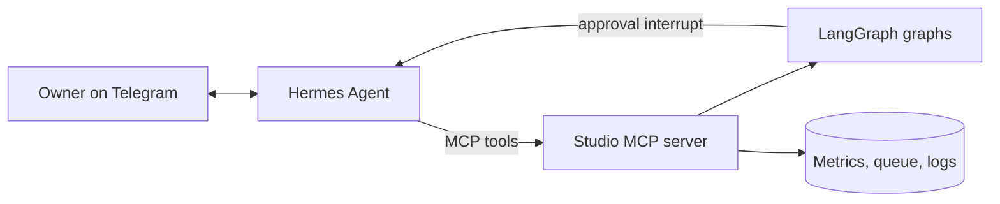

# Roadmap — talking to the media with Hermes Agent

**Status: design only, not built.** Comes after the LangGraph rebuild ([migration/](../migration/)).

## Why
Today the owner drives the studio with fixed Telegram commands (`APPROVE`, `EDIT: …`, `SKIP 2`, `TOPIC: …`).
They work, but they are rigid: every new need is a new command. A conversational agent lets the owner simply ask.

## Division of labour
| Layer | Role | Owns |
|---|---|---|
| **LangGraph** | The pipeline: research → write → design → QA → approval → publish → analyse | State, guards, publication. The only layer that can publish. |
| **Hermes Agent** | The conversation: understands the owner, answers, and calls the pipeline | Dialogue, memory of the owner's preferences, scheduling of small tasks |

Hermes Agent (Nous Research, open source) offers persistent memory, skills, scheduled tasks, a Telegram gateway
and MCP tool support — features to re-check against the version used at build time.

## How they connect

The studio exposes a small **MCP server** in front of the graphs. Hermes only sees these tools:

| Tool | Effect | Guard |
|---|---|---|
| `get_drafts(date)` | Drafts awaiting approval, with sources and media | read-only |
| `approve(id)` / `edit(id, text)` / `reject(id)` | Resumes the graph's approval `interrupt()` | the graph re-runs format checks and QA on an edit |
| `propose_topics(slot, genre, n)` | Runs the scout on demand | read-only until the owner picks |
| `add_topic(text)` | Adds an idea to the backlog | — |
| `get_stats(period, platform)` | Metrics and insights | read-only |
| `explain(id)` | Why this topic, which sources, what QA checked | read-only |

There is **no publish tool**: Hermes can only resume an approval interrupt, and the publish graph still checks
the recorded decision, the account allow-list, the X budget and the music licences.

## What the owner could say
- "What's waiting for tomorrow?" → the three drafts, each with its hook and sources.
- "Shorten the hook of the 13:00 post and approve the rest." → `edit` + QA, then `approve` ×2.
- "How did the Poly-Rythmo thread do compared with last week's?" → `get_stats`.
- "I want more Congolese rumba this month." → stored as a preference; the scout reads it.
- "Why did you pick this album?" → `explain`.

## Risks and limits
- **Conversation is not authorisation**: an ambiguous message must never count as an approval. Hermes asks for
  confirmation; the graph only accepts explicit `approve`/`edit` calls.
- **Prompt injection** through web content or messages: Hermes has no publish tool and no shell; tools are
  allow-listed.
- **Model quality**: if Hermes runs on a smaller open model, keep it to dialogue and routing; research, writing
  and QA stay in the LangGraph nodes on stronger models.
- **One Telegram consumer**: either Hermes or the studio's webhook reads the bot, not both.
- **Hosting**: a second always-on service to run and secure.

## Milestones
1. Studio MCP server with the read-only tools; Hermes answers questions about drafts and stats.
2. Approval tools behind explicit confirmation; side by side with the fixed commands for two weeks.
3. Preferences in memory feeding the scout; fixed commands kept as a fallback.
